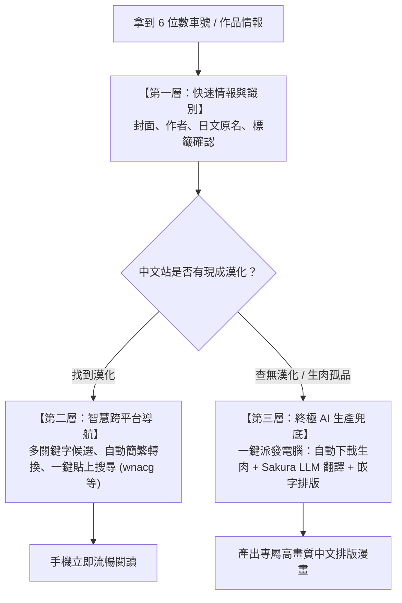

# 紳士漫畫跨平台整合路線圖與技術規劃 (Roadmap)

> **核心理念**：打通「nhentai 索引」、「中文站消費」與「本地 Sakura AI 生產」三者之間的資訊孤島，打造極致流暢的紳士漫畫工作流。

---

## 🧭 核心決策架構（Three-Tier Decision Framework）

---

## 🗺️ 四大演進階段 (Roadmap Stages)

### 📌 Phase 1：標題智慧正規化與多維度搜尋 (Smart Title Normalization)
*目標：在不依賴外部服務的前提下，讓手機端在 wnacg / 中文站的搜尋成功率從 50% 飆升至 90% 以上。*

- [ ] **同人誌標題智慧清洗**：自動以正則表達式剔除括號雜訊（如 `[社團 (作者)] 作品名 (原作) [DL版]`），分離出「純淨作品名」與「作者名」。
- [ ] **多候選關鍵字晶片 (Search Chips)**：在歷史卡片下方提供一排快速按鈕：
  - `[日文原名]`
  - `[作者名]`（跨平台最不容易翻譯出錯的保底詞）
  - `[繁體核心詞]` / `[簡體核心詞]`
- [ ] **自動簡繁互轉**：內建極輕量簡繁對照，自動將搜尋詞轉為簡體，適應不同漢化組的發布習慣。
- [ ] **階梯式 Fallback 貼上**：若日文搜尋無果，點擊晶片即可自動切換至作者名或簡體再次填入搜尋。

---

### 📌 Phase 2：串接本地 Sakura LLM 標題即時轉譯 (Local LLM Title Bridge)
*目標：利用本地強大的 Sakura ACGN 專屬大模型，為日文標題生成最地道的漢化組譯名。*

- [ ] **Ollama 區網端點配置**：手機 App 設定頁支援配置本地電腦的 Ollama 服務位址（如 `http://192.168.x.x:11436`）。
- [ ] **一鍵 Sakura 日翻中**：
  - 呼叫 `sukinishiro:latest` 模型對標題進行 ACGN 語境翻譯。
  - 同時返回「繁體中文譯名」與「簡體中文譯名」。
- [ ] **本地中日對照字典快取 (Offline Alias Cache)**：翻譯過的作品自動快取對應關係，再次查詢時零延遲展示。

---

### 📌 Phase 3：端到端自動化漢化管線 (End-to-End Manga Pipeline)
*目標：遇到網路上無人漢化的生肉本時，手機一鍵發送至電腦，自動生產專屬中文版。*

- [ ] **電腦端輕量橋接服務 (`manga-bridge-server`)**：
  - 採用 `uv` 建立隔離虛擬環境，不污染全域 Python。
  - 提供 RESTful API 供手機派發任務與查詢即時進度。
- [ ] **nhentai 生肉高速下載模組**：自動根據 6 位數解析 media_id 並下載整本原始高畫質圖片。
- [ ] **無縫串接 `folder_translator.py`**：
  - 自動呼叫 `Auto\ComfyUI` 的既有漫畫翻譯流水線（Magi 偵測 + OCR + Sakura LLM + Inpainting + Sakura Layout）。
- [ ] **成果自動發布與打包**：
  - 輸出至指定目錄，並自動打包為 `.cbz` / `.zip`，方便在 PrivateComicReader 或其他閱讀器直接觀看。
- [ ] **手機端「💻 電腦漢化」按鈕與進度追蹤**：手機一鍵派發任務，並能在 App 內查看「下載中 / 翻譯中 / 已完成」狀態。

---

### 📌 Phase 4：封面感知雜湊（pHash）跨站秒比對與私人知識庫 (Perceptual Hash & Vault)
*目標：徹底擺脫文字翻譯差異，實現「看圖認本」跨站秒級映射。*

- [ ] **封面感知雜湊 (pHash / dHash) 計算**：為抓取的封面生成 64-bit 緊湊特徵指紋。
- [ ] **跨平台指紋配對**：比對各中文站的封面縮圖，忽視標題與浮水印差異，精準配對對應本子。
- [ ] **私有跨站映射資料庫**：紀錄 `nhentai <=> wnacg <=> JMComic <=> DLsite RJ` 關聯，打造個人專屬本子知識庫。

---

## 📋 待做事項清單 (TODO Checklist)

### ✅ 已完成 (v2.9)
- [x] 首頁新增「手動輸入 6 位代碼」彈窗，支援點擊剪貼簿狀態直接手動輸入。
- [x] 查詢紀錄即時搜尋過濾功能（支援代碼與標題關鍵字篩選）。
- [x] 查詢紀錄單筆「刪除」功能與清空防呆確認對話框。
- [x] 修復選取文字同時包含代碼與標題時未開啟瀏覽器的 Bug。
- [x] 修復重複查詢代碼時時間戳未刷新置頂的邏輯。
- [x] 修正無障礙服務貼上助手在 wnacg 上的自動點擊搜尋與填入機制。
- [x] 加強標題過濾，排除 Cloudflare、403、Just a moment 等假標題。
- [x] 支援自訂網址主機的 API 端點請求，升級連線 User-Agent 與 Accept 標頭。
- [x] 升級 Java 相容性至 1.8 並配置 release 自動簽署。

### ⏳ 進行中與近期規劃
- [ ] **Phase 1**：實作標題正規化，分離「作者名」與「核心作品名」，在卡片加入搜尋候選 Chips。
- [ ] **Phase 2**：在 App 網址設定加入「本地 Sakura 翻譯主機」設定項，測試區網連線。
- [ ] **Phase 3**：使用 `uv` 建置電腦端 `manga-bridge-server`，驗證 6 位數生肉自動下載 ➔ 自動調用 `folder_translator.py` 翻譯流水線。
